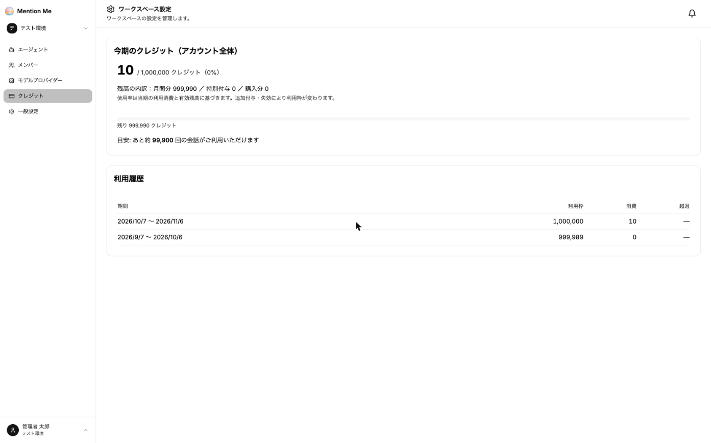

MentionMe の利用量は「クレジット」で管理します。エージェントとの会話などの AI 処理に応じて消費します。

### クレジットを確認する

ワークスペース設定の左メニューから「クレジット」を選択します。

※ 画面はイメージです。表示される数値はご契約内容によって異なります。

**今期のクレジット（アカウント全体）：**
- 今期の消費量と利用枠
- 残高の内訳（月間分 / 特別付与 / 購入分）
- 次回の月間付与日と付与量
- 「あと約何回の会話が利用できるか」の目安

**利用履歴：** 契約期間ごとの利用枠・消費・超過を確認できます。

クレジットは**アカウント（契約）単位**で管理され、アカウントに属するすべてのワークスペースで共有されます。エージェントごとの消費は [ダッシュボード](../../advanced/monitoring/#ダッシュボード)、会話ごとの消費は [チャットログ](../../advanced/monitoring/#チャットログ) で確認できます。

### クレジットを消費する主な処理

- エージェントとの会話（プレイグラウンド・公開ページ・チャットツール・API）
- バージョン比較
- 応答品質ドリフト検知の採点

次の場合はクレジットを消費しません。

- テストの実行・自動評価、対話テスト
- お客さまご自身の API キーを登録したモデルや、Ollama / vLLM など自社環境のモデルでの処理

### 上限に達したとき

- 消費が利用枠の **80%** に達した時点で、メールでお知らせします
- 上限に達した時点でもメールでお知らせし、**エージェントの実行が停止します**
- 停止後は、クレジットが付与されると自動的に再開します

:::caution
**上限に達すると、Web 公開チャットやチャットツール連携も含めてすべて停止します。** 利用者には「ただいまご利用いただけません」と表示されます。80% のお知らせが届いた時点で、担当営業までご相談ください。
:::

### 無料トライアル

無料トライアルは **14日間** ご利用いただけます。期間が終了するとエージェントの実行が停止します。継続してご利用いただく場合は、担当営業までご連絡ください。
