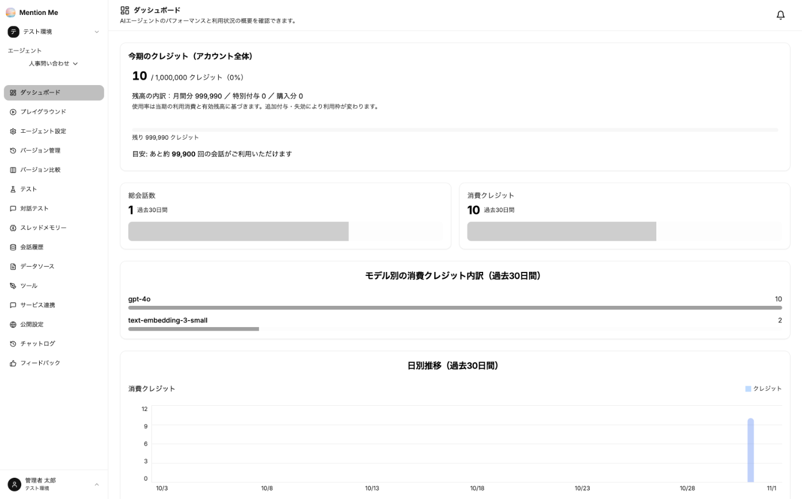
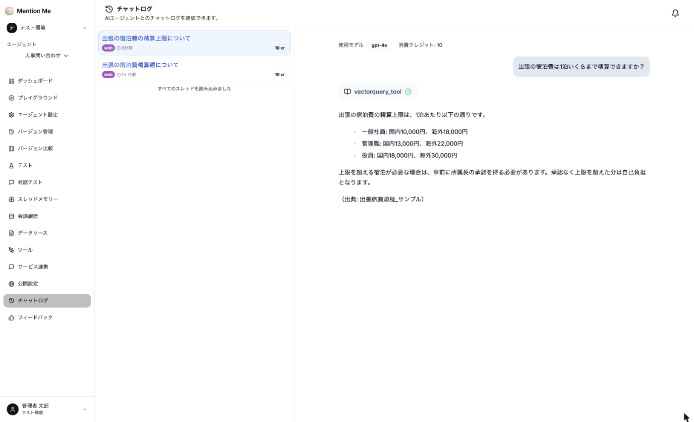
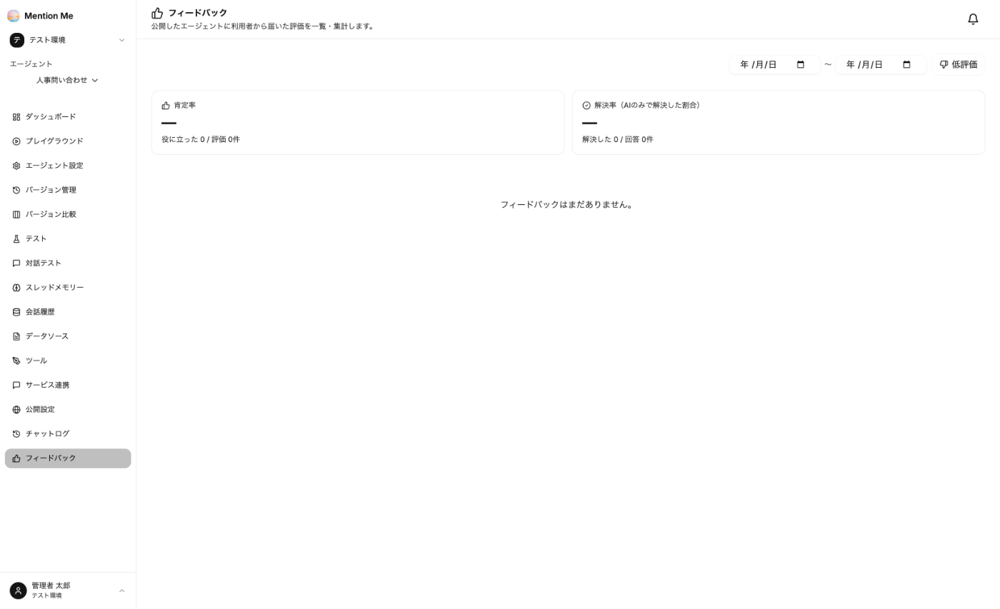

公開後は、利用状況と利用者の評価を見ながら改善を続けます。

### ダッシュボード

エージェントの左メニューから「ダッシュボード」を選択します。

※ 画面はイメージです。表示される数値はご契約内容によって異なります。

- **今期のクレジット（アカウント全体）**：消費量・残高の内訳・次回の付与日と、「あと約何回の会話が利用できるか」の目安
- **総会話数・消費クレジット**（過去30日間）
- **モデル別の消費クレジット内訳**（過去30日間）
- **日別推移**（消費クレジット・チャット数）

### チャットログ

エージェントの左メニューから「チャットログ」を選択すると、利用者とエージェントの会話を確認できます。

- 左側に会話（スレッド）の一覧が、利用経路（web・チャットツールなど）と消費クレジットとともに表示されます
- 会話を選ぶと、右側に質問・回答・使用モデル・消費クレジットと、資料検索（`vectorquery_tool`）などのツール呼び出しが表示されます

答えられていない質問や、資料を参照していない回答を探し、資料の追加やシステムプロンプトの修正につなげます。

### フィードバック

エージェントの左メニューから「フィードバック」を選択すると、公開ページや API の利用者から届いた評価を一覧・集計できます。

| 指標 | 内容 |
| --- | --- |
| 肯定率 | 評価のうち「役に立った（👍）」の割合 |
| 解決率 | 回答のうち、利用者が「解決した」と答えた割合（AI のみで解決した割合） |

期間を指定して絞り込めます。「低評価」で 👎 が付いた回答だけを表示し、「テストケースにする」で [テスト](../../advanced/testing/) に追加できます。

### 運用のコツ

| 頻度 | やること |
| --- | --- |
| 週次 | フィードバックとチャットログで、答えられなかった質問を確認する。資料不足かプロンプトの問題かを切り分ける |
| 月次 | クレジットの消費ペースを確認する |
| 資料改訂時 | 古い資料を削除 → 新しい資料を登録 → 検索テスト → テストの再実行 |

:::tip
**利用が伸びない最大の原因は「答えられない体験」です。** 最初の数問で外すと使われなくなります。公開前の作り込みと、公開直後の改善に時間をかけてください。
:::
