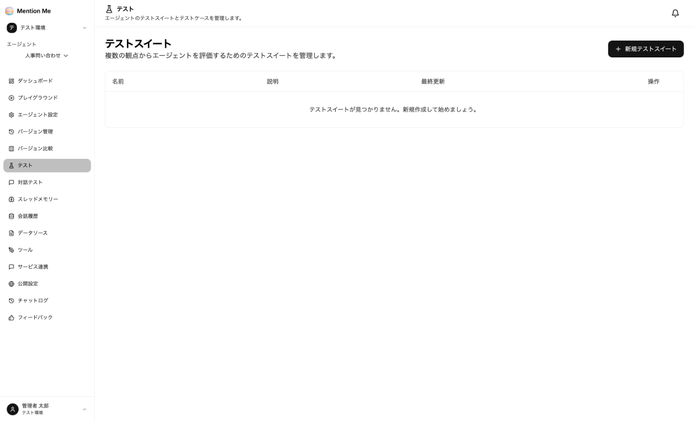

想定質問と期待する回答の観点を登録しておくと、設定や資料を変更したときにまとめて実行し、品質が落ちていないかを確認できます。

### テストスイート

エージェントの左メニューから「テスト」を選択すると、テストスイートの一覧が表示されます。テストスイートは、テストケースのまとまりです（例：回帰テスト）。



1. 「新規テストスイート」をクリック
2. 名前と説明（任意）を入力して「作成」

### テストケースを追加する

テストスイートを開き、テストケースを追加します。追加方法は3つあります。

**1. 手動で追加：**「ケースを追加」から、次の項目を入力します。

| 項目 | 説明 |
| --- | --- |
| 入力メッセージ | 利用者の質問（例：出張の宿泊費の上限は？） |
| 要件 | 回答が満たすべき条件。1行に1つ書きます（例：国内・海外の上限額を示すこと） |
| 期待される出力（参考） | 理想的な回答（任意） |
| タグ | カンマ区切りの分類（任意。例：経費, FAQ） |
| 添付ファイル | 画像などを添付した質問をテストする場合に使います（任意） |

**2. 自動生成：** 作りたいテストケースを文章で説明すると、エージェントの設定（システムプロンプト・データソースなど）を踏まえてテストケースを生成します。生成された候補から追加するものを選びます。

**3. CSV で一括インポート：** 次の列を持つ CSV を貼り付けるか、ファイルを選択します。

```csv
入力メッセージ,期待される出力,要件,タグ
出張の宿泊費の上限は？,役職別の上限額を案内する,正確さ;出典の明示,経費;FAQ
```

「入力メッセージ」のみ必須です。要件・タグを複数書く場合は `;` で区切ります。

### テストを実行する

1. テストスイートの画面で、対象のバージョン（既定は最新設定の Draft）を選ぶ
2. 「テスト実行」をクリック
3. 実行結果で、合格数・不合格数・平均スコアと、各ケースの実際の出力・評価を確認する

実行中は進捗が表示され、途中でキャンセルすることもできます。「自動評価を行う」をオンにすると、要件を満たしているかを AI が採点します。

:::tip
**資料を更新したら再実行してください。** 資料の入れ替えで、それまで答えられていた質問に答えられなくなることがあります。
:::

### 対話テスト

「対話テスト」では、**複数ターンの会話**をシミュレーションしてテストします。AI がユーザー役となって、設定した人物像でエージェントと会話し、会話全体を評価します。

| 項目 | 説明 |
| --- | --- |
| 名前・説明 | シナリオの名前とメモ |
| ペルソナ | ユーザー役の人物像（例：入社1年目の社員。出張は初めてで、精算の流れが分からない） |
| ゴール | ユーザー役が達成したいこと（任意） |
| 最大ターン数・終了条件 | 会話を終える条件（1〜50ターン） |
| エージェントバージョン | テスト対象のバージョン |
| シミュレータのモデル・評価モデル | ユーザー役と評価に使う AI モデル |

シナリオは「自動生成」から、作りたいシナリオを文章で説明して作ることもできます。

:::note
テストの実行・自動評価・対話テストでは、クレジットを消費しません。
:::

### フィードバックからテストケースを作る

[フィードバック](../../advanced/monitoring/#フィードバック) で低評価が付いた質問は、「テストケースにする」からテストスイートに追加できます。実際に利用者がつまずいた質問を、改善後の確認に使えます。
