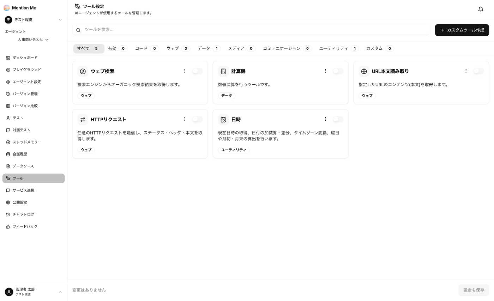

エージェントは、社内資料の検索に加えて「ツール」を使って情報を取得したり計算したりできます。エージェントの左メニューから「ツール」を選択します。

### 標準ツール

| ツール | 内容 |
| --- | --- |
| ウェブ検索 | 検索エンジンからオーガニック検索結果を取得します |
| 計算機 | 数値演算を行います |
| URL本文読み取り | 指定したURLのコンテンツ（本文）を取得します |
| HTTPリクエスト | 任意のHTTPリクエストを送信し、ステータス・ヘッダ・本文を取得します |
| 日時 | 現在日時の取得、日付の加減算・差分、タイムゾーン変換、曜日や月初・月末の算出を行います |

各ツールのスイッチをオンにして、画面右下の「設定を保存」をクリックすると有効になります。上部のタブ（有効 / ウェブ / データ / ユーティリティ など）や検索欄で絞り込めます。

### カスタムツール

「カスタムツール作成」から、自社の API を呼び出す独自ツールを追加できます。

:::tip
**必要なツールだけを有効にしてください。** 使わないツールを有効にすると、エージェントが不要な呼び出しを行い、回答が遅くなります。
:::

:::caution
ウェブ検索・URL本文読み取りで取得した外部の情報は、社内資料とは異なり内容が保証されません。社内規程の問い合わせなど、社内資料だけで答えるべきエージェントでは無効にしておくことをおすすめします。
:::
