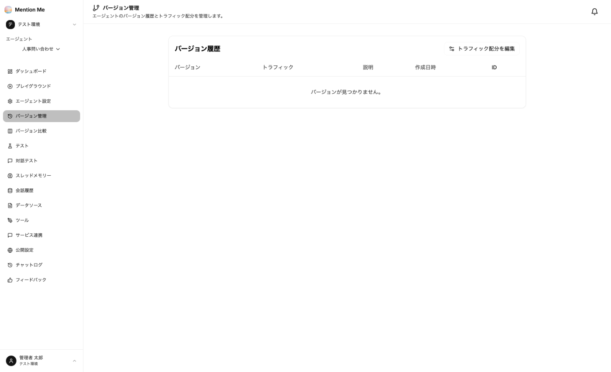

エージェント設定をバージョンとして保存し、切り戻しや比較に使えます。

### バージョン管理

エージェントの左メニューから「バージョン管理」を選択すると、バージョン履歴が表示されます。

**表示項目：**
- バージョン
- トラフィック（そのバージョンに振り分ける会話の割合）
- 説明
- 作成日時
- ID

**バージョンの作成：** [プレイグラウンド](../../guides/playground/) の「バージョンを作成」から、その時点の設定を保存します。

**トラフィック配分：** 「トラフィック配分を編集」で、複数のバージョンを並行稼働させ、会話を一定の割合で振り分けられます。ログインしている利用者には、毎回同じバージョンが割り当てられます。

:::tip
**プロンプトや資料を大きく変える前にバージョンを作成してください。** 品質が落ちたときに戻せます。
:::

### バージョン比較

エージェントの左メニューから「バージョン比較」を選択します。選んだバージョンの出力を、**同じ入力で横並びに見比べられます。**

1. 「比較を作成」をクリック
2. 比較するバージョンと、入力する質問を指定
3. 実行して、各バージョンの回答を見比べる

プロンプトの書き換えやモデルの変更が、回答にどう影響するかを確認するときに使います。

:::note
バージョン比較の実行にはクレジットを消費します。
:::
