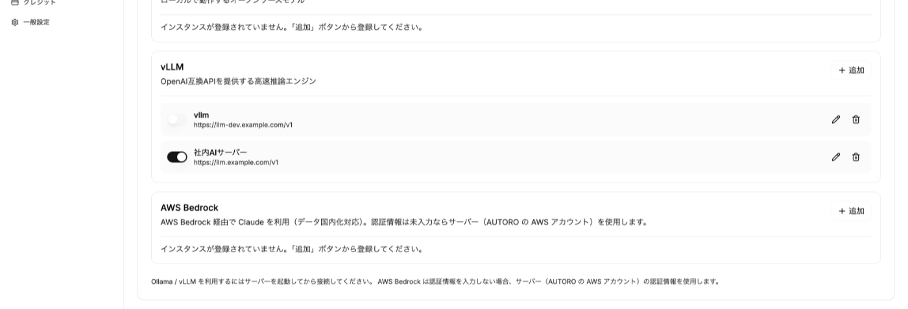
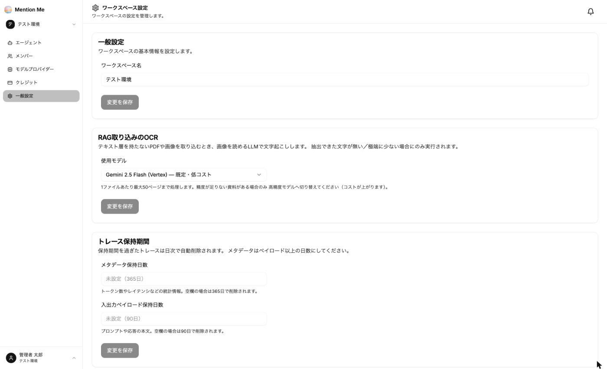

ワークスペース設定の「モデルプロバイダー」と「一般設定」で、ワークスペース全体に関わる設定を行います。

### モデルプロバイダー

標準で利用できるモデル（OpenAI・Google・Anthropic など）に加えて、次の接続先を追加できます。

| プロバイダー | 内容 |
| --- | --- |
| Ollama | お客さまの環境で動作するオープンソースモデル |
| vLLM | OpenAI 互換 API を提供する推論サーバー。お客さまの環境内のモデルを使えます |
| AWS Bedrock | AWS Bedrock 経由で Claude を利用します。リージョンに東京・大阪を選べるため、データを国内で処理できます |

1. 使うプロバイダーの「追加」をクリック
2. 表示名（例: 本番環境）と接続先 URL、必要に応じて認証情報を入力
3. 保存すると、エージェント設定のモデル選択に表示されます

同じプロバイダーに複数の接続先（インスタンス）を登録でき、スイッチで有効・無効を切り替えられます。

:::note
Ollama・vLLM を利用する場合は、サーバーを起動してから接続してください。接続できない場合、エージェント設定のモデル選択に赤いエラーが表示されます。
:::

### 一般設定

| 項目 | 内容 |
| --- | --- |
| ワークスペース名 | 表示名の変更 |
| RAG取り込みのOCR | 文字情報を持たない PDF や画像を取り込むときに、文字起こしに使うモデル。既定は低コストのモデルです。精度が足りない資料がある場合のみ高精度モデルに切り替えてください（コストが上がります） |
| トレース保持期間 | 回答生成の記録（トレース）を保持する日数。メタデータ（トークン数・処理時間など）は既定365日、入出力の本文は既定90日 |
| 会話履歴の保持期間 | エージェントの会話履歴を保持する日数。空欄の場合は無期限に保持します |

保持期間を過ぎたデータは日次で自動削除されます。
