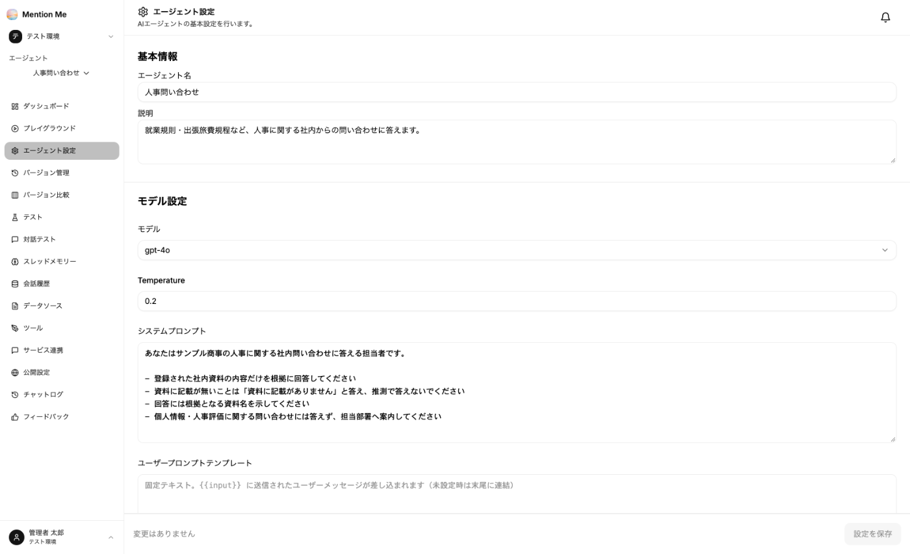

エージェントの左メニューから「エージェント設定」を選択すると、エージェントの基本設定画面が表示されます。



### 設定項目

**基本情報：**

| 項目 | 説明 |
| --- | --- |
| エージェント名 | 利用者に見える名前 |
| 説明 | 何に答えるエージェントか |

**モデル設定：**

| 項目 | 説明 |
| --- | --- |
| モデル | 使用する AI モデル |
| Temperature | 回答のばらつき。値が大きいほど表現が多様になる代わりに、事実と異なる回答が増えます。**社内問い合わせ用途では 0〜0.3 を推奨**します |
| システムプロンプト | エージェントへの指示文。**回答品質に最も効く項目です** |
| ユーザープロンプトテンプレート | 利用者の入力の前後に必ず付ける固定文。`{{input}}` の位置に入力が差し込まれます（未設定時は末尾に連結） |

**出典の表示：**

「出典を表示する」をオンにすると、社内資料を参照した回答の下に出典（ファイル名と、ページ番号またはセクション見出し）が表示されます。この設定は**公開 Web チャット**に適用されます。プレイグラウンドと API での出典は、プレイグラウンドの「引用情報を返す」で設定します。

**応答品質ドリフト検知：**

「ドリフト検知を有効にする」をオンにすると、本番の会話を日次で採点し、品質が前の期間より下がったときに管理者へ通知します。「1日あたりの採点件数」で採点する会話の数を指定します。

:::caution
ドリフト検知の採点にはクレジットを消費します。
:::

変更したら、画面右下の「**設定を保存**」をクリックしてください。保存しないと反映されません。

### システムプロンプトの書き方

最低限、次の4点を書いてください。

```
あなたは<会社名>の<業務領域>に関する社内問い合わせに答える担当者です。

- 登録された社内資料の内容だけを根拠に回答してください
- 資料に記載が無いことは「資料に記載がありません」と答え、推測で答えないでください
- 回答には根拠となる資料名を示してください
- 個人情報・人事評価に関する問い合わせには答えず、担当部署へ案内してください
```

:::tip
**「資料に無いことは答えない」「根拠の資料名を示す」の2点は必ず入れてください。** 入れないと一般知識で答えてしまい、利用者が社内規程と誤認する原因になります。
:::

### ユーザープロンプトテンプレートの注意点

利用者に見せたくない指示（判定ルールや社内向けの但し書きなど）は、**テンプレートではなくシステムプロンプトに書いてください。**

テンプレートを後から変更すると、変更前に行われた会話からテンプレート部分を取り除けなくなり、公開ページの会話表示に変更前のテンプレートがそのまま表示されることがあります。特に先頭部分を変更した場合は何も取り除けません。テンプレートに機密を書いてしまった場合は、テンプレートを直すのではなく、公開ページの公開を停止してください。
