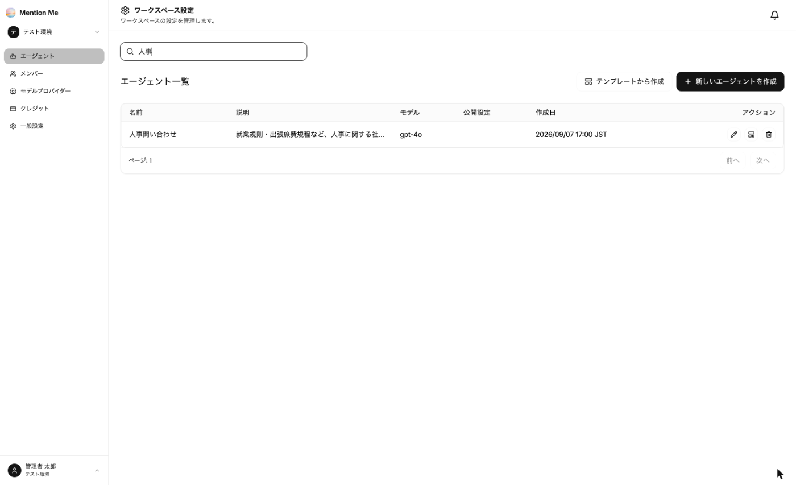
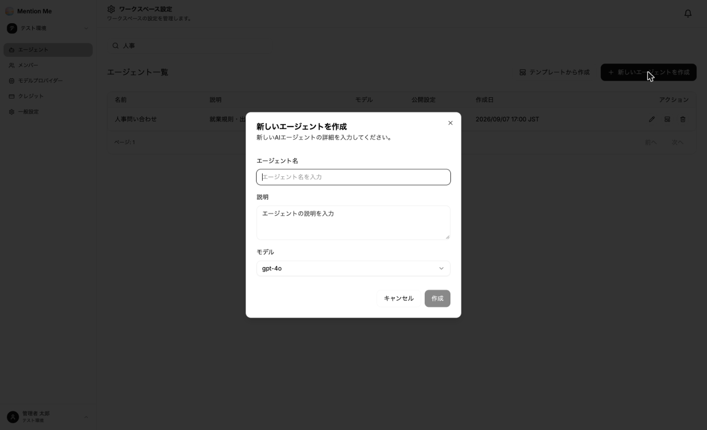

> **運用の起点です。** エージェントは用途ごとに作ります。作成したら [③-2 エージェントを設定する](../../guides/agent-settings/) で指示文を書き、[③-3 社内資料を登録する](../../guides/knowledge/) に進みます。

### エージェント一覧画面

ワークスペース設定の左メニューから「エージェント」を選択すると、エージェント一覧が表示されます。

**表示項目：**
- 名前
- 説明
- モデル
- 作成日
- アクション（編集 / テンプレートとして保存 / 削除）

上部の検索欄で、エージェント名による絞り込みができます。

### 新しいエージェントを作成する

1. 「新しいエージェントを作成」をクリック

2. 以下の情報を入力：
   - **エージェント名**：利用者に見える名前です。「人事問い合わせ」など用途がわかる名前にしてください
   - **説明**：何に答えるエージェントかを書きます
   - **モデル**：使用する AI モデルを選びます（後から変更できます）
3. 「作成」をクリック

作成したエージェントの名前をクリックすると、エージェントの画面（ダッシュボード）が開きます。

### テンプレートを使う

よく使う設定をテンプレートとして保存し、そこから新しいエージェントを作成できます。部署ごとに同じ構成のエージェントを用意するときに便利です。

**テンプレートとして保存：**

1. エージェント一覧の「アクション」列にある「テンプレートとして保存」アイコンをクリック
2. テンプレート名・説明・カテゴリ（例: サポート）・タグ（例: 社内, FAQ）を入力して保存

**テンプレートから作成：**

1. エージェント一覧の「テンプレートから作成」をクリック
2. 名前・カテゴリ・タグで絞り込み、使うテンプレートを選択
3. エージェント名を入力して作成

| テンプレートに含まれるもの | 含まれないもの |
| --- | --- |
| モデル、システムプロンプト、ユーザープロンプトテンプレート、Temperature、標準ツール、スレッドメモリーの設定 | データソース（社内資料）、カスタムツール、APIキー、公開設定、チャット連携 |

:::note
テンプレートは**保存した時点のスナップショット**です。テンプレートや元のエージェントを後から変更しても、作成済みのエージェントには反映されません。
:::

### エージェントの分け方

| 良い例 | 避けたい例 |
| --- | --- |
| 「人事問い合わせ」「経費精算」「情シスヘルプデスク」と用途ごとに分ける | 「社内なんでも質問」に全部署の資料を入れる |
| 社外公開用と社内用を分ける | 社外秘資料を入れたエージェントを社外に公開する |

用途を絞るほど、関係のない資料を根拠にした回答が減り、テストもしやすくなります。
