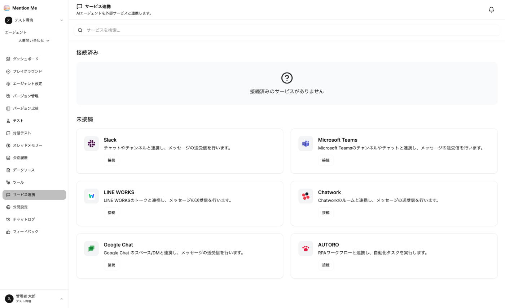

エージェントをチャットツールと連携すると、普段使っているチャットからエージェントにメンションして質問できます。エージェントの左メニューから「サービス連携」を選択します。

画面上部の「接続済み」に連携中のサービスが、「未接続」に連携できるサービスが表示されます。

### 対応サービス

| サービス | 連携の単位 |
| --- | --- |
| Slack | チャンネル・DM |
| Microsoft Teams | チャンネル・チャット |
| LINE WORKS | トーク |
| Chatwork | ルーム |
| Google Chat | スペース・DM |
| AUTORO | RPA ワークフローと連携し、自動化タスクを実行 |

連携はエージェント単位で作成します。エージェントごとに別のチャンネルやアプリへ繋げられます。

### 連携の流れ

1. 連携するサービスの「接続」をクリック
2. チャットツール側でアプリ（Bot）を作成し、表示された認証情報を MentionMe に入力
3. 「接続テスト」で疎通を確認して「接続」
4. MentionMe に表示される受信先 URL を、チャットツール側のアプリ設定に登録

:::note
チャットツール側でのアプリ登録・権限付与が必要なため、**対象チャットツールの管理者権限が必要**です。
:::

### サービスごとに入力する情報

| サービス | 入力する情報 | 取得先 |
| --- | --- | --- |
| Slack | Signing Secret / Bot User OAuth Token | Slack アプリの設定画面 |
| Microsoft Teams | Microsoft App ID / App Password（クライアントシークレット） | Azure Bot Service（Azure Portal） |
| LINE WORKS | Bot ID / ドメインID / Client ID / Client Secret / Bot Secret / Service Account ID / 秘密鍵 | LINE WORKS Developer Console |
| Chatwork | APIトークン / Webhookトークン | Chatwork の API 設定・Developer Center |
| Google Chat | プロジェクト番号 / サービスアカウントのメールアドレス / サービスアカウントの秘密鍵 | Google Cloud コンソール |

**Slack の場合：** 連携画面からアプリの「マニフェスト」をコピーできます。Slack でアプリを新規作成するときにマニフェストを貼り付けると、必要な権限とイベント設定がまとめて設定されます。

### 既存の Slack アプリを別のエージェントに繋ぎ替える

すでに使っている Slack アプリを別のエージェントに繋ぎ替えるときは、**受信先の Request URL が変わります。** 新しいアプリを作らず、次の手順で切り替えてください。

1. 繋ぎ替え先のエージェントで Slack 連携を作成する
2. 連携画面の「既存アプリに繋ぐ」から、新しい **Request URL** をコピーする
3. Slack アプリ設定の左メニュー「Event Subscriptions」を開き、「Request URL」欄を新しい値に貼り替えて保存する

:::caution
古い Request URL のままだと、メンションがエージェントに届きません。
:::

### Slack の DM で使う

既存の Slack アプリで DM（ダイレクトメッセージ）からも質問できるようにするには、Slack アプリ設定の「Event Subscriptions」に `message.im` イベントを追加してください。チャンネルで使う場合は、チャンネルに Bot を招待する必要があります。

### チャットツールでの使い方

- 連携したチャンネルでエージェントの Bot に**メンション**して質問します
- チャットツールでの会話も [チャットログ](../../advanced/monitoring/#チャットログ) に記録されます
- クレジットの残高がなくなると、チャットツールからの利用も停止します
