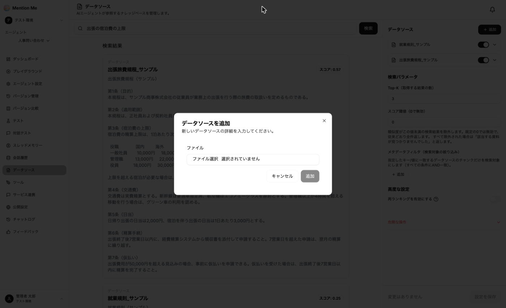
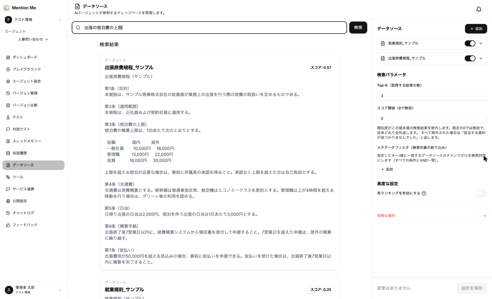

エージェントが回答の根拠にする社内資料を「データソース」として登録します。エージェントの左メニューから「データソース」を選択します。

### 初回のみ：ナレッジの作成

初めて開いたときは、ナレッジの作成画面が表示されます。

| 項目 | 説明 |
| --- | --- |
| Embedding モデル | 資料を検索用に変換するモデルです。**後から変更できません** |
| Top-K | 1回の回答で参照する資料の件数（既定は3） |

### 資料を追加する

1. 画面右上の「追加」をクリック

2. ファイルを選択すると、次の項目が表示されます：
   - **名前**：一覧と回答の出典表示に使われます。利用者が見て分かる名前にしてください
   - **メタデータ**（任意）：業務カテゴリなどのキー/値。検索対象の絞り込みに使えます
   - **個人情報マスキング**（任意）：取り込む資料の個人情報をマスクしてから保存します（既定はオフ）
   - **チャンク戦略**：資料の分割方法。通常は「Auto（拡張子から自動）」のままで問題ありません
3. 「追加」をクリック

追加すると取り込み処理が始まります。完了するとスイッチが有効になり、検索対象になります。スイッチをオフにすると、資料を削除せずに検索対象から外せます。

**対応しているファイル形式：**

| 分類 | 拡張子 |
| --- | --- |
| 文書 | pdf / docx / pptx / txt / md |
| 表計算 | xlsx / xls / xlsm / csv / tsv |
| マークアップ | json / html / htm |
| 画像 | png / jpg / jpeg / webp |

- Excel・Word・PowerPoint は、セルや本文だけでなく**図形・テキストボックス内の文字も抽出**します
- 文字情報を持たないスキャン PDF や画像は、**OCR で文字起こし**して取り込みます（1ファイルあたり最大50ページ）

### 検索パラメータ

画面右側で、検索の挙動を調整できます。

| 項目 | 説明 |
| --- | --- |
| Top-K | 取得する結果の数 |
| スコア閾値 | 類似度がこの値未満の結果を除外します。0で無効。すべて除外された場合は「該当する資料が見つかりませんでした」と返します |
| メタデータフィルタ | 指定したキー/値に一致するデータソースだけを検索対象にします（すべての条件に AND で一致） |
| 再ランキングを有効にする | 検索結果を並べ替えて精度を上げます |

変更したら「設定を保存」をクリックします。

### 検索テスト

画面上部の検索欄に想定質問を入力して「検索」をクリックすると、**どの資料のどの部分がどのスコアで取得されるか**を確認できます。

:::tip
**資料を登録したら必ず検索テストを行ってください。** 期待した資料が出てこない場合は、分割方法か、資料そのものの書き方（見出しの有無など）に原因があります。
:::

### 登録前に確認すること

| 観点 | 内容 |
| --- | --- |
| 最新版か | 旧版が混ざると古い規程を根拠に回答します。**改訂時は古い資料を削除**してください |
| 公開してよい範囲か | ワークスペースのメンバーは、登録資料の内容を引き出せます。**限定公開の資料は別ワークスペースに分けてください** |
| 個人情報が含まれていないか | 氏名・連絡先などが含まれる資料は、そのまま回答に現れる可能性があります。マスキングは完全ではないため、登録すべきでない情報は登録しないでください |
| 長すぎないか | 長大なファイルは分割して登録してください |
