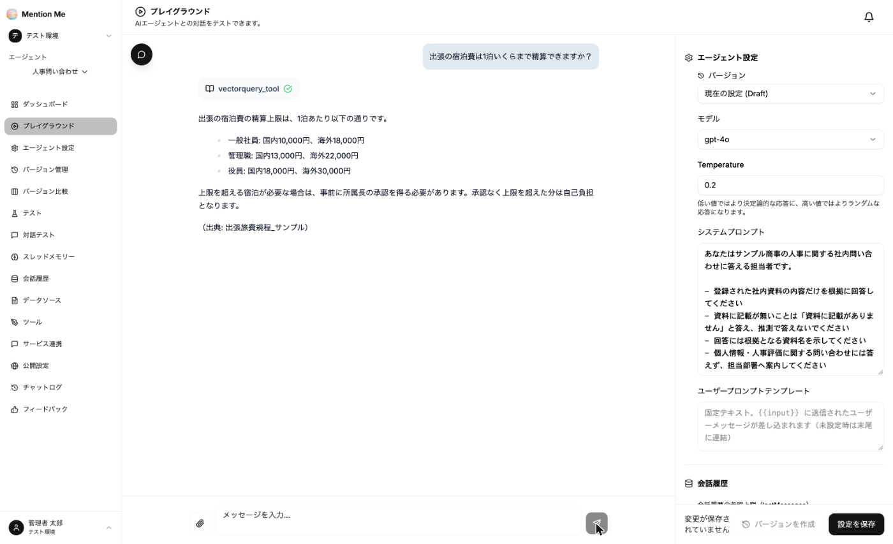

プレイグラウンドは、設定を変えながらその場で回答を試せる画面です。エージェントの左メニューから「プレイグラウンド」を選択します。

### 画面構成

- **左側**：チャット。下部の入力欄に質問を入力し、送信ボタンを押すか Ctrl + Enter（Mac は ⌘ + Enter）で送信します（Enter キーは改行です）
- **右側**：エージェント設定。バージョン・モデル・Temperature・システムプロンプト・ユーザープロンプトテンプレート・会話履歴の参照上限などを変更できます

右側で変更した設定は、「設定を保存」で保存されるまでエージェントには反映されません。保存前に何度でも試せます。

### 回答の見方

回答の上に表示される `vectorquery_tool` は、**エージェントが社内資料を検索したことを示します。** この表示が出ていない回答は、資料を参照していません。

回答の末尾には、根拠にした資料名が表示されます（システムプロンプトで指示している場合）。

### 出力形式（JSON で返す）

右側の「出力形式」で「JSON（構造化出力）」を選ぶと、エージェントは決めた形の JSON だけを返します。帳票の読み取りなど、回答をシステムで受け取る用途に使います。システムプロンプトで形を指示するだけの場合と違い、形が崩れた JSON は返りません。

形は次のどちらかで決めます。どちらで編集しても、保存される内容は同じです。

- **フィールドで編集**：フィールドごとに名前・型・説明・必須を入力します。型は 文字列・数値・整数・真偽値・オブジェクト・配列 から選べます。文字列に選択肢を入れると、その中のどれかだけを返します
- **JSON で編集**：JSON Schema を直接書きます。API の `response_format` の `json_schema.schema` と同じ書き方です

- 説明はモデルに渡されます。「税込みの合計。カンマなしの数値」のように、何を入れるかを書くと精度が上がります
- 値がないことがある項目は「必須」をオフにしてください。値がないときは null が入るか、キーごと省かれます（モデルによって異なります）
- 設定はプレイグラウンド・公開 Web チャット・[API](../../advanced/api/#response_format) に反映されます。Slack・LINE WORKS などのチャットツール連携には反映されません
- 質問と関係ない入力にも JSON の形で答えます。書類を読み取らせるときは、書類ごとに新しい会話にしてください

### バージョンを作成する

画面右下の「バージョンを作成」から、その時点の設定をバージョンとして保存できます。保存したバージョンは [バージョン管理](../../advanced/versions/) で確認・比較できます。

### 公開前に確認すること

公開前は必ずプレイグラウンドで確認してください。最低限、次の3種類を試します。

1. **答えられるはずの質問**：正しい資料を根拠に答えるか
2. **資料に無い質問**：「記載がありません」と答えるか（推測で答えないか）
3. **答えてはいけない質問**：個人情報や人事評価などを断るか

:::tip
確認した質問は [テスト](../../advanced/testing/) に登録しておくと、設定や資料を変更したときにまとめて再確認できます。
:::
