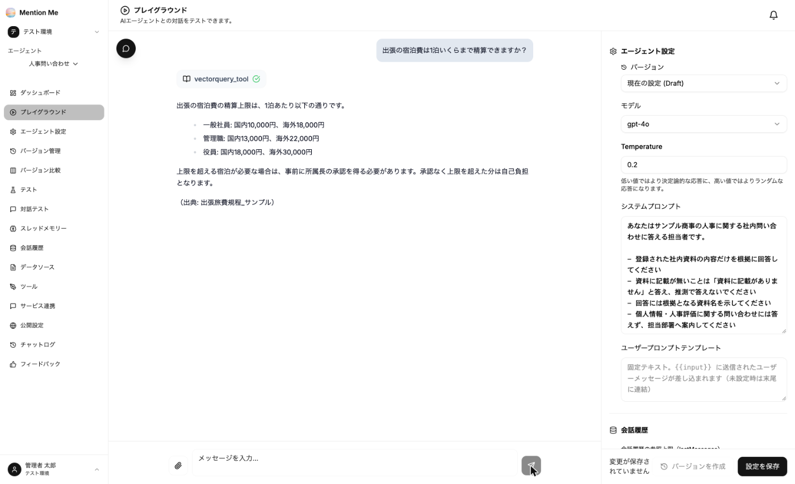

プレイグラウンドは、設定を変えながらその場で回答を試せる画面です。エージェントの左メニューから「プレイグラウンド」を選択します。

### 画面構成

- **左側**：チャット。下部の入力欄に質問を入力し、送信ボタンを押すか Ctrl + Enter（Mac は ⌘ + Enter）で送信します（Enter キーは改行です）
- **右側**：エージェント設定。バージョン・モデル・Temperature・システムプロンプト・ユーザープロンプトテンプレート・会話履歴の参照上限などを変更できます

右側で変更した設定は、「設定を保存」で保存されるまでエージェントには反映されません。保存前に何度でも試せます。

### 回答の見方

回答の上に表示される `vectorquery_tool` は、**エージェントが社内資料を検索したことを示します。** この表示が出ていない回答は、資料を参照していません。

回答の末尾には、根拠にした資料名が表示されます（システムプロンプトで指示している場合）。

### バージョンを作成する

画面右下の「バージョンを作成」から、その時点の設定をバージョンとして保存できます。保存したバージョンは [バージョン管理](../../advanced/versions/) で確認・比較できます。

### 公開前に確認すること

公開前は必ずプレイグラウンドで確認してください。最低限、次の3種類を試します。

1. **答えられるはずの質問**：正しい資料を根拠に答えるか
2. **資料に無い質問**：「記載がありません」と答えるか（推測で答えないか）
3. **答えてはいけない質問**：個人情報や人事評価などを断るか

:::tip
確認した質問は [テスト](../../advanced/testing/) に登録しておくと、設定や資料を変更したときにまとめて再確認できます。
:::
