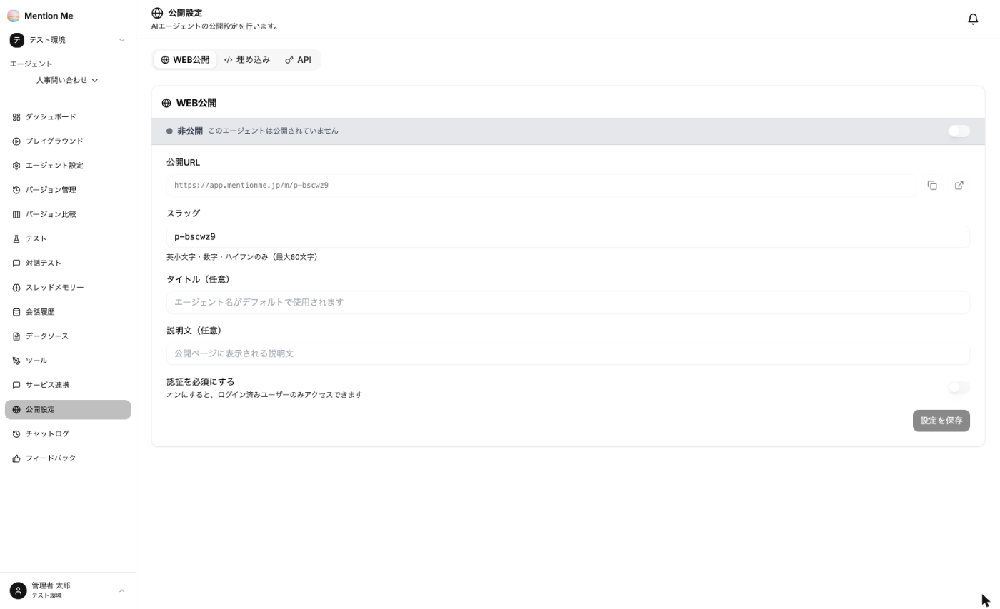
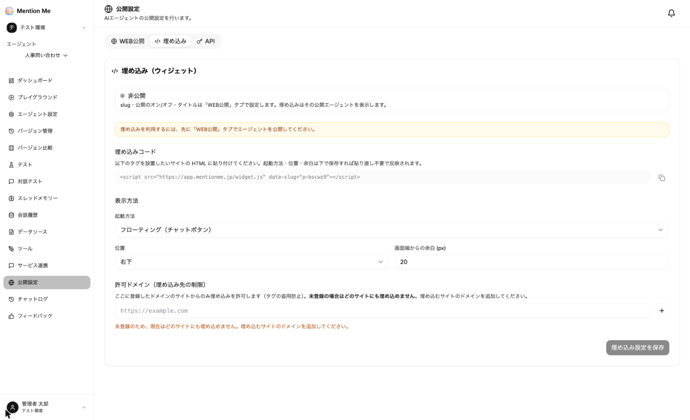
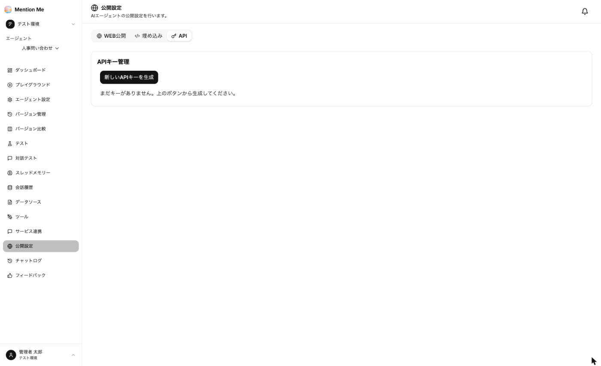

エージェントの左メニューから「公開設定」を選択します。**WEB公開 / 埋め込み / API** の3つのタブがあります。

### WEB公開

利用者がブラウザから直接使えるチャットページを公開します。

1. 右上のスイッチをオンにする
2. 以下を設定して「設定を保存」をクリック

| 項目 | 説明 |
| --- | --- |
| 公開URL | 公開ページのURL。コピーボタンと、別タブで開くボタンがあります |
| スラッグ | 公開URLのパス。英小文字・数字・ハイフンのみ（最大60文字）。既定値が自動で入ります |
| タイトル（任意） | 未入力ならエージェント名が使われます |
| 説明文（任意） | 公開ページに表示される説明 |
| 認証を必須にする | オンにすると、MentionMe にログインしているユーザーのみアクセスできます |

:::danger
**「認証を必須にする」がオフの場合、URL を知っていれば誰でも利用できます。** また、オンにした場合も、アクセスできるのは「MentionMe にログインしているユーザー」であり、**自社のワークスペースのメンバーに限定されるわけではありません。** 社外秘の資料を登録したエージェントは Web 公開せず、[チャットツール連携](../../guides/integration/) など利用者を限定できる方法でご利用ください。
:::

公開ページでは、利用者が回答に 👍/👎 を付けたり、解決したかどうかを回答したりできます。集計は [フィードバック](../../advanced/monitoring/#フィードバック) で確認できます。

### 埋め込み

自社サイトや社内ポータルに、チャットをウィジェットとして埋め込みます。**先に「WEB公開」タブでエージェントを公開してください。**

1. 「埋め込みコード」をコピーし、設置したいサイトの HTML に貼り付けます
2. 表示方法を設定します

| 項目 | 説明 |
| --- | --- |
| 起動方法 | フローティング（画面隅のチャットボタン）など |
| 位置・画面端からの余白 | チャットボタンを表示する位置 |
| 許可ドメイン | 埋め込みを許可するサイトのドメイン。**未登録の場合はどのサイトにも埋め込めません** |

3. 「埋め込み設定を保存」をクリック

起動方法・位置・余白は、保存すればコードを貼り直さなくても反映されます。

### API

エージェントを自社システムから呼び出すための APIキーを発行します。

1. 「新しいAPIキーを生成」をクリック
2. 表示された APIキーをその場でコピー

:::caution
**発行時に表示されたキーは、その場でコピーしてください。以後は確認できません。** 不要になったキーは削除してください。
:::

API の使い方は [API で呼び出す](../../advanced/api/) をご覧ください。
