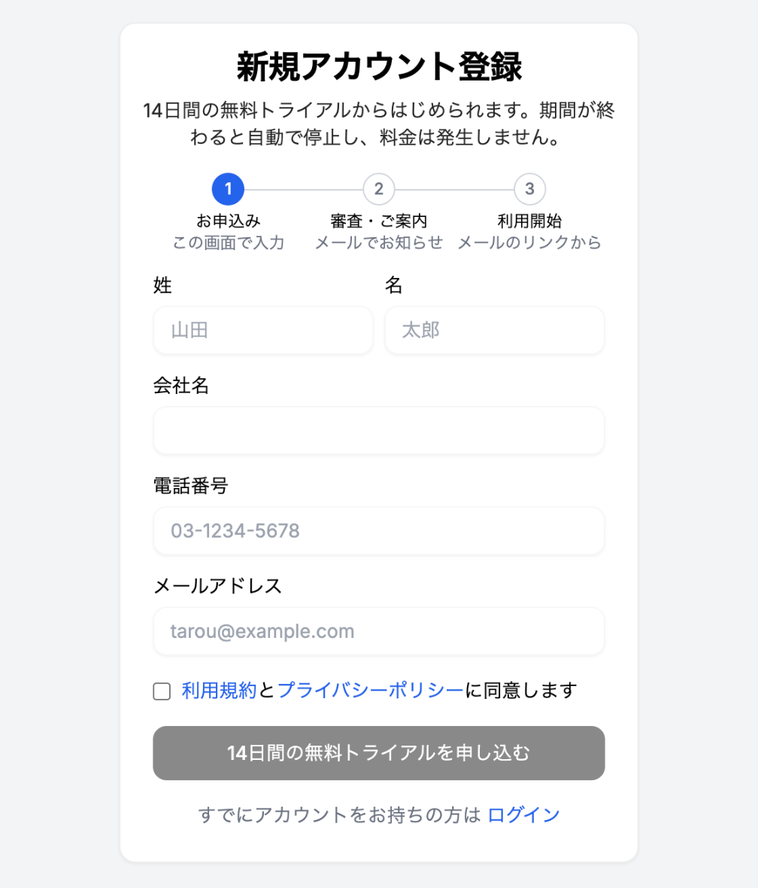
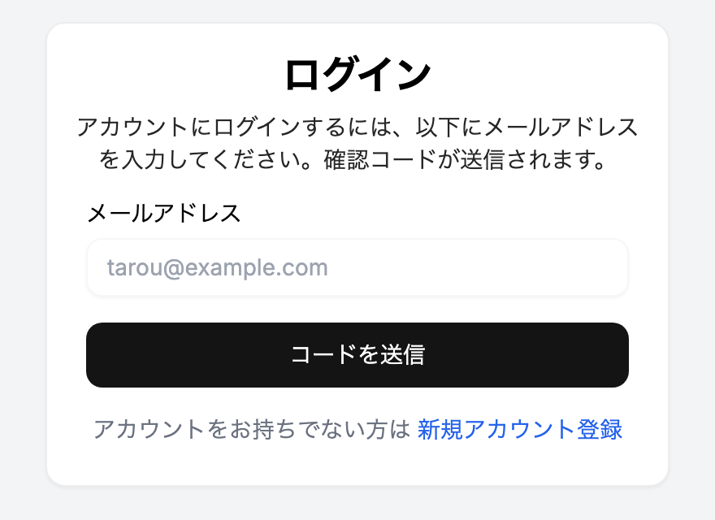
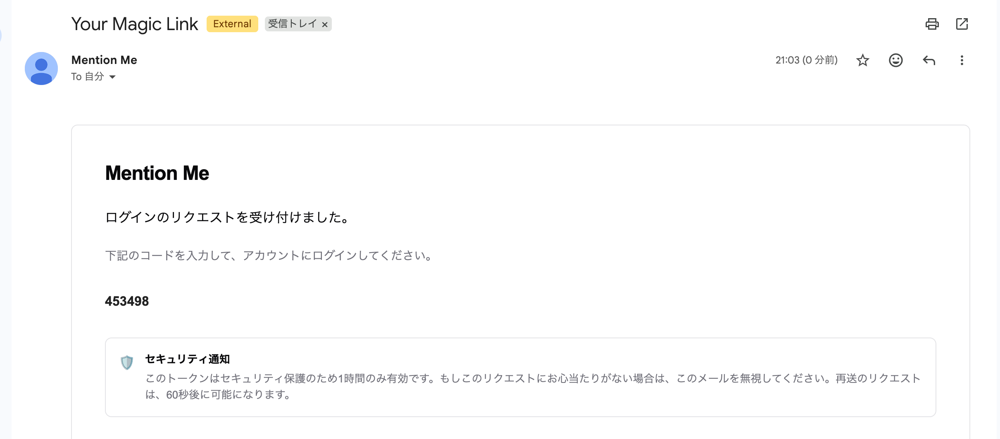
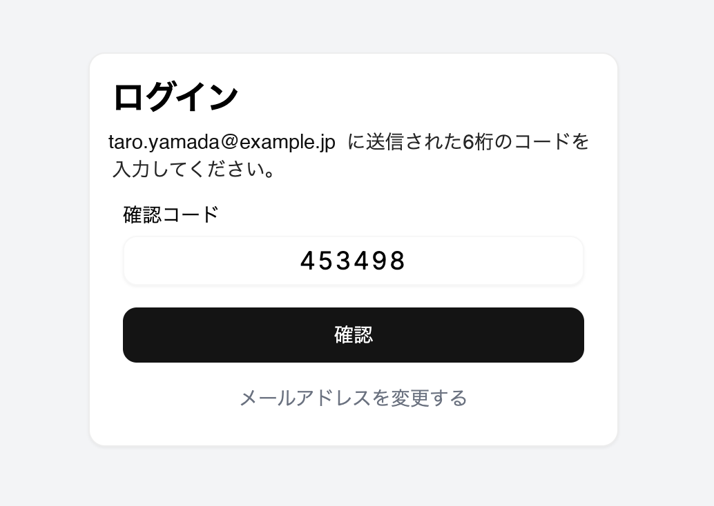

MentionMe を初めて使うときは、**新規アカウント登録**（14日間の無料トライアルのお申込み）が必要です。お申込みの審査後にメールでご案内が届き、そこから利用を開始します。2回目以降は、メールで届く確認コードでログインします。

:::note
ワークスペースに**招待されたメンバー**の方は、新規アカウント登録は不要です。届いた招待メールのリンクから参加してください。
:::

## 新規アカウント登録

### 1. お申込み

1. https://app.mentionme.jp/auth/signup にアクセスします（ログイン画面の「新規アカウント登録」からも開けます）
2. 次の項目を入力します：
   - **姓・名**
   - **会社名**
   - **電話番号**
   - **メールアドレス**
3. 利用規約とプライバシーポリシーを確認し、同意にチェックします
4. 「14日間の無料トライアルを申し込む」をクリックします

「お申込みを受け付けました」と表示されれば完了です。パスワードの設定はありません。

### 2. 審査・ご案内

お申込み内容を確認のうえ、メールでご案内します。

### 3. 利用開始

1. ご案内メールの**利用開始リンク**を開きます
2. 表示されたメールアドレスを確認し、「利用を開始する」をクリックします。ここから14日間の無料トライアルが始まります
3. メールで届く6桁の確認コードを入力し、「ログインする」をクリックします
4. 「アカウントを作成しました」の画面で「ワークスペース一覧へ」をクリックします

続けて [ワークスペースを作成する](../../implementation/2-workspace/) に進みます。

:::note
無料トライアルの期間が終わると、エージェントの実行が自動で停止します。料金は発生しません。継続してご利用いただく場合は、担当営業までご連絡ください。
:::

## ログイン（2回目以降）

MentionMe にはパスワードがありません。ログインのたびに、メールで届く6桁の確認コードを入力します。

### 1. メールアドレスを入力する

1. https://app.mentionme.jp/auth/signin にアクセスします
2. 「メールアドレス」にご自身のメールアドレスを入力します
3. 「コードを送信」をクリックします

### 2. 確認コードを受け取る

差出人「Mention Me」からメールが届きます。本文に記載された6桁の数字が確認コードです。

- 確認コードの有効期限は **1時間** です
- コードを再送するときは、「メールアドレスを変更する」で戻り、もう一度「コードを送信」をクリックします（前回の送信から **60秒** 経過後に可能です）

### 3. 確認コードを入力する

ログイン画面の「確認コード」に6桁の数字を入力し、「確認」をクリックします。

入力したメールアドレスが誤っていた場合は「メールアドレスを変更する」から入力し直してください。

ログインが完了すると、ワークスペース一覧が表示されます。

## うまくいかないとき

| 症状 | 対処 |
| --- | --- |
| 確認コードやご案内のメールが届かない | 迷惑メールフォルダを確認してください。社内のメールセキュリティ製品で隔離されていないか、社内のシステム管理者にもご確認ください |
| 確認コードを入力してもログインできない | 有効期限（1時間）が切れている可能性があります。コードを再送し、最新のメールに記載されたコードを入力してください |
| 「送信回数が多すぎます」と表示される | しばらく時間をおいてから、もう一度お試しください |
| 誤ったメールアドレスにコードを送った | 「メールアドレスを変更する」から正しいメールアドレスを入力し直してください |
