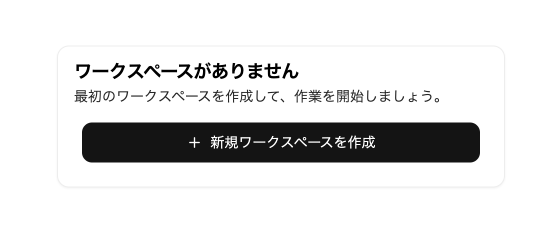
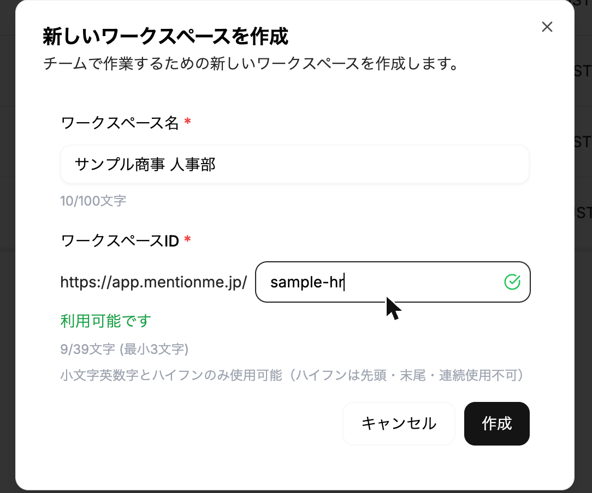
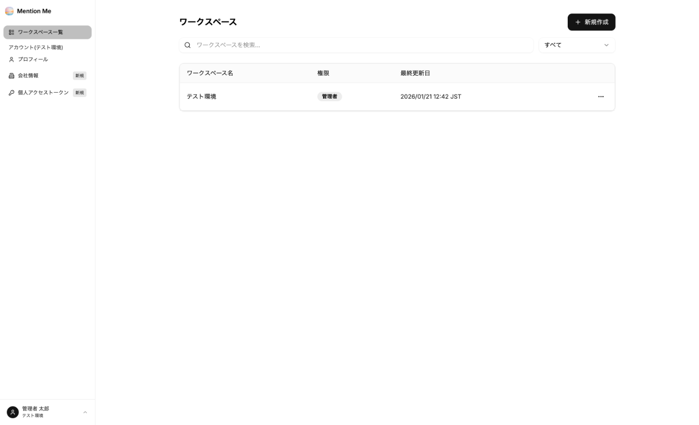

ワークスペースは、チーム・部署単位の管理区画です。エージェントとメンバーはワークスペースに属します。1つのアカウント（契約）の中に、複数のワークスペースを作成できます。

### ワークスペースを作成する

[新規アカウント登録](../../implementation/1-sign-in/#新規アカウント登録) で利用を開始すると、「ワークスペースがありません」と表示されます。「新規ワークスペースを作成」をクリックします。

次の項目を入力し、「利用可能です」と表示されたことを確認して「作成」をクリックします。

| 項目 | 説明 |
| --- | --- |
| ワークスペース名 | 表示名です（日本語可・100文字以内） |
| ワークスペースID | URLの一部になります。小文字英数字とハイフンのみ・3〜39文字。ハイフンは先頭・末尾・連続で使えません |

:::caution
**ワークスペースIDは作成後に変更できません。** また、全利用者で重複できないため、使用済みの場合は別のIDを入力してください。
:::

ワークスペース一覧に作成したワークスペースが表示されれば完了です。作成した方がワークスペースの**オーナー**になります。

**ワークスペースを作成できる方：**
- 新規アカウント登録で利用を開始した方（最初の1つ）
- 既存ワークスペースの**オーナー**（2つ目以降の追加）

管理者・メンバー・ゲストとして参加しているだけでは、ワークスペースを追加できません。作成できない場合はボタンが無効になり、「ワークスペースを作成できません。管理者にお問い合わせください」と表示されます。

:::note
作成直後に権限が「メンバー」と表示される場合があります。画面を再読み込みすると「オーナー」と表示されます。
:::

### ワークスペース一覧

ログイン後や左メニューの「ワークスペース一覧」から、所属しているワークスペースを確認できます。

- ワークスペース名をクリックすると、そのワークスペースに移動します
- 検索欄で名前による絞り込み、右上のプルダウンで権限による絞り込みができます
- 「新規作成」から追加のワークスペースを作成できます

### 次のステップ

- [メンバーを管理する](../../implementation/3-members/)
- [③-1 エージェントを作る](../../guides/create-agent/)
