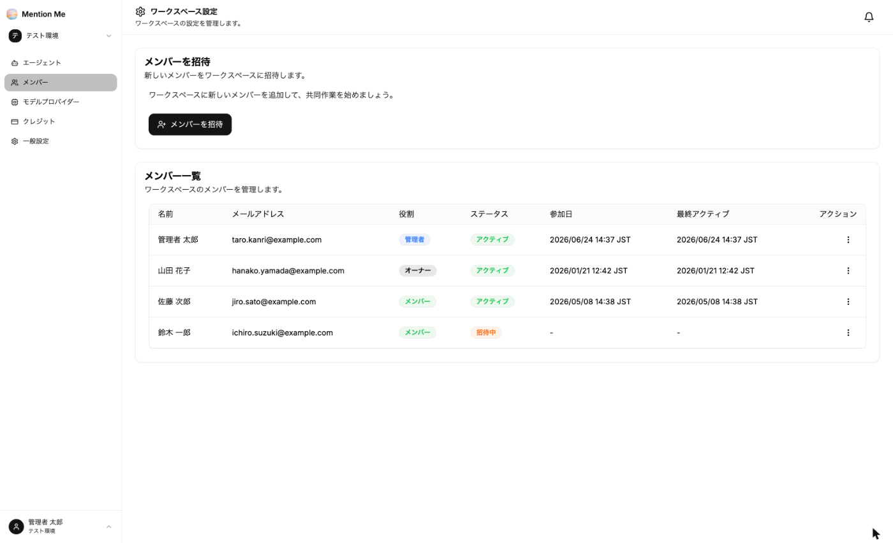

ワークスペース設定の左メニューから「メンバー」を選択すると、メンバーの一覧と招待ボタンが表示されます。

**表示項目：**
- 名前
- メールアドレス
- 役割（オーナー / 管理者 / メンバー / ゲスト）
- ステータス（アクティブ / 招待中）
- 参加日
- 最終アクティブ

### メンバーを招待する

1. 「メンバーを招待」をクリック
2. 次の項目を入力：
   - **氏名**
   - **メールアドレス**
   - **ロール**（オーナー / 管理者 / メンバー / ゲスト）
3. 招待を送信

招待されたメンバーにはメールが届きます。メールのリンクから参加すると、ステータスが「アクティブ」になります。

### 役割（権限）

| 役割 | できること |
| --- | --- |
| オーナー | ワークスペースのすべての操作。メンバーの削除、会社情報の編集、契約プランの確認もできます |
| 管理者 | エージェント・データソース・連携の作成・編集・削除、メンバーの招待と役割変更 |
| メンバー | エージェント・データソース・連携の作成・編集（削除はできません） |
| ゲスト | 閲覧のみ |

### 役割の変更・削除

一覧の右端「︙」メニューから、役割の変更やメンバーの削除ができます。

:::caution
**退職・異動の際は必ずメンバーから削除してください。** 削除すると、そのワークスペースのエージェントと会話履歴にアクセスできなくなります。
:::
