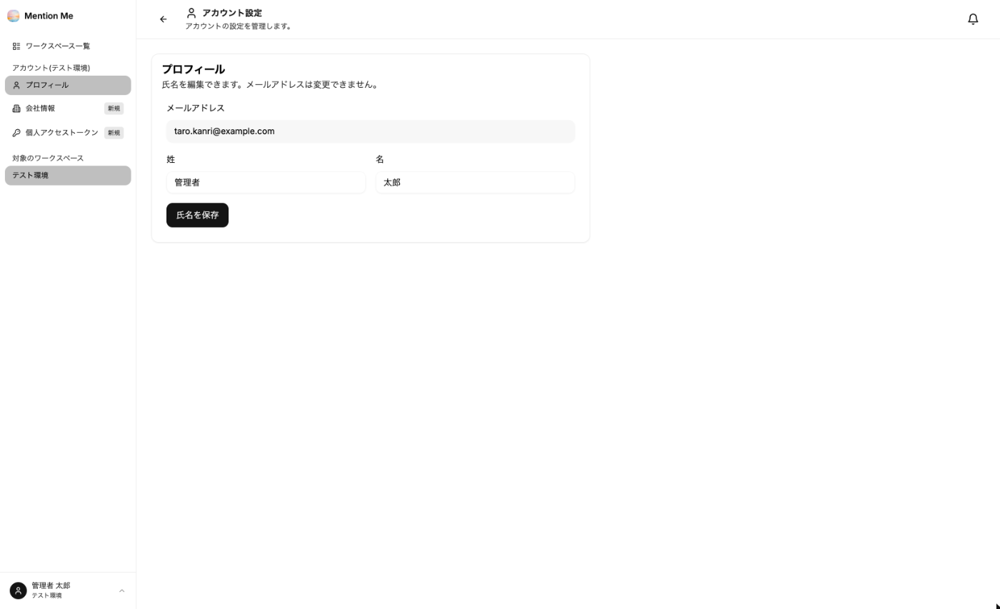
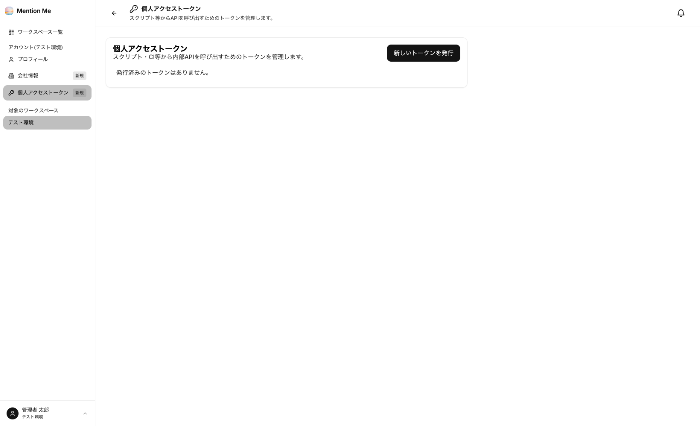

画面左下のユーザーメニューから「アカウント設定」を開くと、ご自身のプロフィールと、所属するアカウント（契約）の情報を管理できます。

### プロフィール

氏名を編集できます。メールアドレスは変更できません。

### 会社情報

請求書・契約書に記載される情報です。閲覧は全員ができ、**編集はオーナーのみ**できます。

| 項目 | 内容 |
| --- | --- |
| 会社名・会社名（カナ） | 請求書・契約書の宛名 |
| 部署名・担当者名 | ご担当者の情報 |
| 電話番号・請求先メールアドレス | 連絡先・請求書の送付先 |
| 住所 | 郵便番号・都道府県・市区町村・番地・建物名 |
| 法人番号・適格請求書発行事業者番号 | 該当する場合に入力します |

### プラン

アカウント単位の契約内容を確認できます。**オーナーのみ表示できます。**

| 項目 | 内容 |
| --- | --- |
| プラン名・月額料金 | ご契約中のプラン |
| 含有クレジット/月・超過単価 | 毎月付与されるクレジットと、超過した場合の単価 |
| 契約開始日・次回更新日 | 契約期間 |
| エージェント数/上限・ユーザー数/上限 | 現在の利用数とプランの上限 |

オーナーには、このほか「請求・クレジット」と「支払い履歴」のメニューも表示されます。

### 個人アクセストークン

スクリプトや CI などから MentionMe の API を呼び出すためのトークンを発行・管理します。

1. 「新しいトークンを発行」をクリック
2. **用途名**（例: CI用トークン）と**有効期限（日数）**を入力して「発行」
3. 表示されたトークンを「トークンをコピー」でその場でコピー

一覧では、各トークンの状態・有効期限・最終利用日時を確認でき、不要になったトークンは「失効する」で無効化できます。

:::caution
**トークンは発行時にしか表示されません。** 紛失した場合は、古いトークンを失効させて発行し直してください。トークンはパスワードと同様に扱い、第三者と共有しないでください。
:::

:::note
エージェントを外部システムから呼び出す場合は、個人アクセストークンではなく、エージェントごとの **APIキー** を使います。[③-5 公開する](../../guides/publish/#api) をご覧ください。
:::
