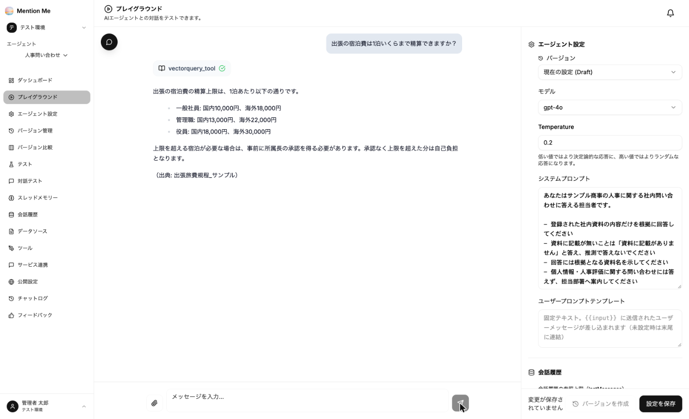

ようこそMentionMeへ！

MentionMe は、**社内の資料に基づいて答える AI エージェントを、作る・試す・配る・改善するまで一貫して運用できる**サービスです。
管理者が資料と振る舞いを設定し、想定質問でのテストで品質を確かめてから公開できます。利用者は Web 画面や、普段お使いの Slack・Microsoft Teams などのチャットツールから質問するだけで使えます。

## 利用の流れ

| ステップ | 内容 | 参照ページ |
| --- | --- | --- |
| 1. 準備 | ログインし、ワークスペースを作成してメンバーを招待する | [2. 導入する](./implementation/1-sign-in/) |
| 2. エージェントを作る | 用途ごとにエージェントを作成し、指示文（システムプロンプト）を書く | [③-1](./guides/create-agent/)・[③-2](./guides/agent-settings/) |
| 3. 社内資料を登録する | 回答の根拠にするマニュアルや規程をアップロードする | [③-3](./guides/knowledge/) |
| 4. 試して直す | プレイグラウンドで回答を確認し、設定を調整する | [③-4](./guides/playground/) |
| 5. 届ける | Web 公開・サイト埋め込み・チャットツール連携で利用者に届ける | [③-5](./guides/publish/)・[③-6](./guides/integration/) |
| 6. 改善する | テスト・フィードバック・チャットログで品質を確認し、改善を続ける | [4. もっと活用する](./advanced/testing/) |

## 主なユースケース

| ユースケース | エージェントの例 |
| --- | --- |
| 情シスのヘルプデスク | VPN・PC・アカウントの手順書を読ませ、「VPNが繋がらない」に手順を案内する |
| 人事・総務の問い合わせ対応 | 就業規則・経費精算規程を読ませ、「有給の繰越は何日まで？」に規程の該当箇所つきで答える |
| 営業支援 | 製品仕様・価格表・過去の提案書を読ませ、商談中の確認や提案のたたき台づくりに使う |
| カスタマーサポートの一次対応 | 製品マニュアルとFAQを読ませ、一次回答を作る。公開ページとして社外にも出せる |

## このドキュメントの読み方

- **管理者の方**（エージェントを作成・運用する方）は「1. はじめに」から順にお読みください。
- **利用者の方**（エージェントに質問して使う方）は「[5. 利用者の方へ](./users/ask/)」をご覧ください。
